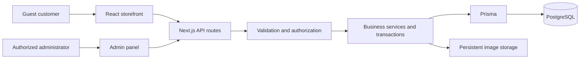

# Architecture

## Overall structure

The complete application is a modular Next.js application with React pages and server route handlers. It uses Prisma to access PostgreSQL. The public storefront and administration have independent layouts and share validated business services.

## Order data flow

1. A customer chooses a configured product capacity, service, and quantity.
2. Checkout validates the submitted contact information and enabled delivery zone.
3. The server reloads authoritative prices and service rules from PostgreSQL.
4. A transaction saves the order, original item/price/address snapshots, history, and required stock or custody records.
5. Guest requests arrive for staff review. Confirmation enforces eligibility and stock rules.
6. The admin panel displays the order from the same database; visible panels refresh every 15 seconds.
7. Authorized staff record payment, refill/exchange progress, dispatch, and delivery.
8. A customer checks status using an order number and private token.

## Main data concepts

| Concept | Purpose |
| --- | --- |
| Product and variant | Catalog information and an explicitly configured gas/capacity combination |
| Offer | Workflow, customer type, price, and eligibility rules |
| Customer | Contact and staff verification/blocking state |
| Order and item snapshots | Submitted details, original prices, totals, and operational status |
| Inventory pool and movement | Aggregate counts and an auditable movement ledger |
| Refill job and exchange record | Custody and cylinder service workflows |
| Delivery zone | Enabled service coverage and fees |
| Session and audit | Authentication state and administrator action history |

## Security boundaries

- Browser input cannot set authoritative prices or administrator roles.
- Every administrative endpoint independently requires an ADMIN session.
- Passwords use salted scrypt hashing; opaque session tokens are stored as digests.
- Production session cookies use HttpOnly, Secure, and SameSite protections.
- Mutations check request origin and validate input; rate limits reduce repeated abuse.
- Private tracking avoids exposing order lists through a phone number alone.
- Uploaded raster images are bounded, validated, and re-encoded. Draft images require admin access.

These controls describe the implementation, not an independent security audit. Production still requires HTTPS, appropriate secret management, monitoring, and tested backups.
