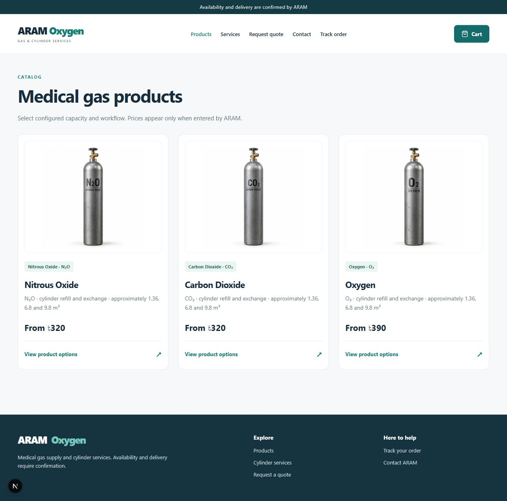

# ARAM Oxygen — Project Portfolio

**A full-stack gas-cylinder commerce and operations application.**

Built with **Next.js · React · TypeScript · PostgreSQL · Prisma · Docker**.

This public repository is a project case study for recruiters. It contains screenshots, architecture, feature explanations, selected code excerpts, and verification notes. The complete application is maintained separately and is not included here. Downloading this portfolio does not provide a runnable copy of the application.

## What the project does

Customers browse gas products, choose a cylinder capacity and service, and place orders without creating an account. Staff use a separate authenticated panel to review orders, maintain products and prices, manage stock, and coordinate delivery.

## Engineering highlights

- **Guest checkout connected to admin:** PostgreSQL stores each submitted order; the dashboard reads the same records and refreshes while visible.
- **Reliable ordering:** server-calculated prices, delivery charges, identity-bound idempotency keys, and serializable transactions.
- **Cylinder workflows:** separate handling for customer-owned refills, ARAM-owned exchange stock, and outright purchases.
- **Protected administration:** role checks on the page and API endpoints, database-backed sessions, validation, and audit records.
- **Owner-managed catalog:** editable product specifications, capacity/service prices, images, availability, and delivery rules.
- **Order history:** search, status filters, pagination, original price snapshots, and reversible deletion/restoration.
- **Verification:** unit checks, API security/workflow tests, concurrency scenarios, and browser checks during development.

## Quick review

| What to review | Document |
| --- | --- |
| Features and technical work | [Project case study](CASE-STUDY.md) |
| System structure and data flow | [Architecture](ARCHITECTURE.md) |
| Selected implementation examples | [Code walkthrough](CODE-WALKTHROUGH.md) |
| Testing scope and limitations | [Verification](VERIFICATION.md) |
| Interface previews | [Screenshots](SCREENSHOTS.md) |

## Technology choices

| Area | Implementation |
| --- | --- |
| Frontend | React, Next.js App Router, TypeScript, responsive CSS, Lucide icons |
| Backend | Node.js with Next.js route handlers and Zod validation |
| Database | PostgreSQL, Prisma ORM, versioned SQL migrations |
| Authentication | Custom opaque sessions, token digests, salted scrypt password hashing |
| Image handling | Sharp validation/re-encoding and persistent upload storage |
| Local development | Docker Compose, VS Code tasks, Windows startup helpers |
| Verification | Vitest, API integration scripts, Playwright browser scripts |

## Public portfolio boundaries

This repository deliberately excludes application source files, dependency manifests, database schemas/migrations, executable setup scripts, credentials, customer records, database backups, and original uploaded media. Code excerpts are explanatory fragments, not a complete implementation.

The owner can demonstrate the complete application separately. No public deployment, payment gateway, external security certification, or automatic notification service is claimed.

The previous public version used the MIT license. That license remains in [LICENSE](LICENSE); this portfolio does not revoke rights or copies obtained from earlier public releases.
