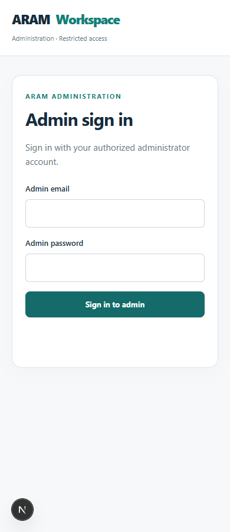

# Interface previews

The catalog screenshot was captured from the existing local full application on 1 November 2026. The blank mobile admin sign-in preview comes from the October 2026 development screenshots. They show interface design, not a publicly hosted service. Displayed catalog information is an interface snapshot and may change in the owner's private system.

## Customer product catalog

The storefront shows product images, concise descriptions, configured starting prices, and product-option links. Its navigation has shopping, enquiries, tracking, and cart access without admin or customer login links.

## Separate administrator access

The administration route has its own restricted sign-in layout. No credentials or customer records are shown in this screenshot.

The implemented dashboard sections and workflows are described in the [case study](CASE-STUDY.md). Authenticated business screens are intentionally not published because they can expose private operational data.
